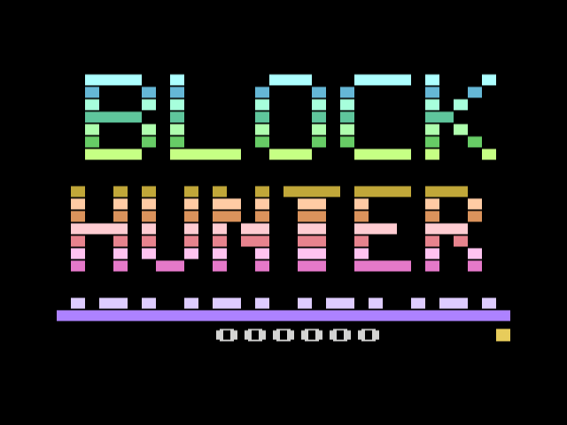
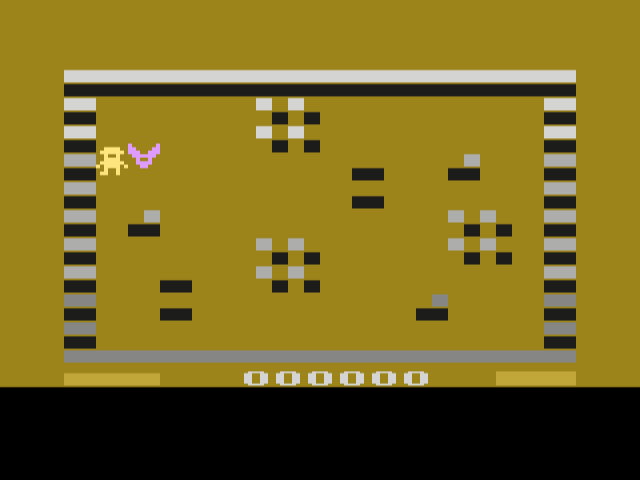
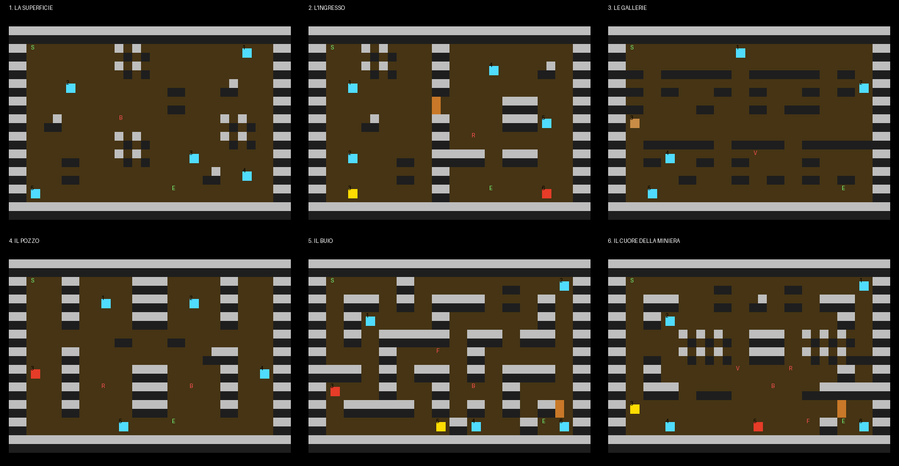

# BLOCK HUNTER 2600

Versione per **Atari 2600** del gioco HTML5 *Block Hunter* (regole prese dal motore SpikeEngine). Cartuccia da **8K con Superchip** (bankswitching F8SC, 128 byte di RAM in più), PAL, scritta in batari Basic con quasi tutto il codice in assembly.

Sei un minatore e scendi in miniera, livello dopo livello: dalla superficie sabbiosa fino al cuore della miniera, tra passaggi stretti fra le buche, rocce che cadono, massi che rotolano e quattro nemici.

 

Si gioca anche nel browser, dalla pagina con l'emulatore nella radice della repo ([`../index.html`](../index.html), pulsante *Block Hunter*).

## Comandi

| Comando | Effetto |
| --- | --- |
| Joystick | Muove il minatore (anche in diagonale) |
| Pulsante con la levetta spinta | **Salto** di 2 caselle in quella direzione (sopra una buca, una roccia o un masso) |
| Pulsante con la levetta al centro | **Dinamite** nella direzione in cui guardi |
| Game Select (nel titolo) | Livello di partenza (le tacche in basso a destra) |
| Game Reset, o pulsante nel titolo | Nuova partita |

## Come si gioca

- In ogni livello gli **oggetti** compaiono **uno alla volta**: prendi quello che lampeggia e compare il successivo. Dopo l'ultimo compare l'**uscita** (il rettangolo largo che lampeggia piano): toccala e si scende al livello dopo.
  - **gemma** +50 punti · **chiave** apre le porte · **cassa** +3 candelotti di dinamite · **cuore** +1 vita · **asse** copre la prima buca in cui metti il piede
- **Buche** (la fessura nera): ci cadi, perdi una vita e riparti dall'inizio del livello. Si saltano.
- **Sabbia** (a scacchi): rallenta per qualche secondo.
- **Porte** (la mezza casella verticale): si aprono camminandoci contro con la chiave.
- **Rocce che cadono**: l'ombra lampeggia per un secondo, poi la roccia resta lì. Se ti cade addosso perdi una vita. Cadono solo dove hanno tutto intorno pavimento libero, così non chiudono mai un passaggio.
- **Massi**: entrano dai lati del livello e rotolano di casella in casella. Contro un ostacolo si spaccano in due pezzi che vanno di lato (i pezzi si sbriciolano al colpo dopo); nelle buche cadono.
- **Dinamite**: va dritta ed esplode contro muri, rocce, massi o porte; rocce e massi nelle 3×3 caselle intorno saltano (+10 ciascuno). Uccide i nemici che tocca, tranne il fantasma. Barra in basso a **sinistra**: candelotti rimasti (si parte con 6).
- **Vite**: 5 (barra in basso a destra). Dopo un colpo il minatore lampeggia ed è invulnerabile per 2 secondi; anche durante il salto non lo tocca niente. Dopo il sesto livello si ricomincia dal primo con una vita in più.

| Nemico | Colore | Comportamento |
| --- | --- | --- |
| Pipistrello | viola | Vola sopra i muri a caso; dopo 4 voli si posa per 2 secondi. Se hai preso una gemma te la ruba (torna al suo posto), se no ti toglie una vita. Dinamite: +12 |
| Ragno | azzurro | Va di casella in casella e ti insegue se sei vicino; evita buche e sabbia. Morso: una vita e -20 punti. Dinamite: +20 |
| Serpente | verde | Striscia a caso. Il morso toglie una vita e fa **ricominciare il livello**. Ucciso con la dinamite (+20) torna dopo 2 secondi |
| Fantasma | bianco | Passa attraverso i muri; la dinamite non gli fa niente |

Al massimo 2 nemici alla volta (si alternano sullo schermo): quando uno muore entra il successivo del livello.

## I livelli



| | Livello | Novità |
| --- | --- | --- |
| 1 | La superficie | sabbia, buche, rocce che cadono, pipistrello |
| 2 | L'ingresso | il muro della miniera con la porta: prima la chiave, poi dentro; ragno |
| 3 | Le gallerie | tre gallerie dove i massi rotolano da sinistra e da destra, campi di buche con passaggi stretti, l'asse, serpente |
| 4 | Il pozzo | pozzi verticali con i massi dall'alto e dal basso, la luce che traballa, ragno e pipistrello |
| 5 | Il buio | luce spenta: vedi solo intorno alla lampada, ogni tanto un lampo; labirinto, chiave e porta, fantasma e pipistrello |
| 6 | Il cuore della miniera | massi da tutti i lati, rocce frequenti, chiave e porta, i 4 nemici a coppie |

I livelli sono in [`levels/level1.json`](levels/level1.json) … `level6.json` (mappe di 16×11 caselle scritte a caratteri, vedi [`tools/convert_levels.py`](tools/convert_levels.py)); il convertitore controlla che ogni oggetto e l'uscita si raggiungano nell'ordine (con la porta aperta solo dopo la chiave) e disegna la tavola.

## Cosa è cambiato rispetto all'originale (per stare in 8K)

- Una schermata per livello (16×11 caselle da 8×8 pixel), niente scorrimento; 6 livelli inventati per la cartuccia invece dei mondi dell'originale.
- Gli oggetti arrivano uno alla volta (come l'opzione *gemsOneByOne* dell'originale) e l'uscita dopo l'ultimo.
- Tolti: timer, carrello, elmetto, acqua, fango, schegge delle rocce, modalità a 2 giocatori. Il pipistrello ruba una gemma, ma la rimette al suo posto invece di lasciarla cadere.
- La lampada del livello buio illumina una fascia intorno al minatore invece di un cono.
- Il morso del serpente fa ricominciare il livello (nell'originale si torna al primo livello del mondo).

## Come è fatto

- **Playfield da 22 righe** di 4 linee nella RAM della Superchip (`pfres = 22`): ogni casella è 2×2 pixel del playfield e il suo **tipo è scritto nel motivo** dei 4 pixel, così la mappa non occupa altra RAM: muro pieno, buca = metà bassa, sabbia e roccia = motivi diversi, porta = metà sinistra. Righe chiare e scure alternate danno il rilievo.
- Colori per riga con 4 tavolozze intrecciate in una pagina; la lampada del buio e l'arcobaleno del titolo sono strisce che scorrono spostando il puntatore della tabella (vedi [`tools/gen_tables.py`](tools/gen_tables.py)).
- Banco 1: logica (movimento, salto, dinamite, nemici, rocce, massi). Banco 2: kernel, livelli e caricatore, titolo, colori, suoni e musica. Le routine delle caselle sono in una macro copiata nei due banchi.
- Sprite: minatore (player 0), nemici (player 1, due alternati), dinamite (missile 0), oggetto (ball).

## Compilare e provare

```sh
python3 tools/convert_levels.py     # -> levels.asm e screenshots/tavola_livelli.png
python3 tools/gen_tables.py         # -> gfx.asm, pal.inc, title.inc
# batari Basic 1.9 + dasm: compila BlockHunter.bas (con i file .asm e .inc nella stessa cartella)
python3 tests/test_logic.py bin/BlockHunter.bas.bin bin/BlockHunter.bas.sym     # 36 test, ~30 s
xvfb-run -a python3 tests/test_stella.py bin/BlockHunter.bas.bin /tmp/bh        # 14 test in Stella
```

- [`tests/test_logic.py`](tests/test_logic.py) gira la ROM in un emulatore minimo (py65 con gli opcode illegali del kernel e la Superchip, [`tests/sim.py`](tests/sim.py)) e controlla: movimento e muri, sabbia, buche, salto, dinamite e rocce, rocce che cadono, oggetti e uscita, passaggio al livello 2, porta e chiave, ragno che insegue e morde, dinamite sul ragno, serpente (resta nella mappa, il morso fa ricominciare), pipistrello che ruba la gemma, massi che arrivano e si spaccano, fine della partita; e che ogni frame duri lo stesso numero di linee.
- [`tests/test_stella.py`](tests/test_stella.py) gioca in Stella con la tastiera (avvio, movimento, dinamite, salto, Reset, Select per ogni livello) e fa le schermate.

| File | Contenuto |
| --- | --- |
| `BlockHunter.bas` | il gioco |
| `levels/`, `levels.asm` | livelli (JSON) e dati per la cartuccia |
| `gfx.asm`, `pal.inc`, `title.inc` | tavolozze, sprite e titolo (generati) |
| `bin/` | ROM, listato e simboli |
| `../release/block_hunter/BlockHunter.bin` | la ROM da scaricare |
