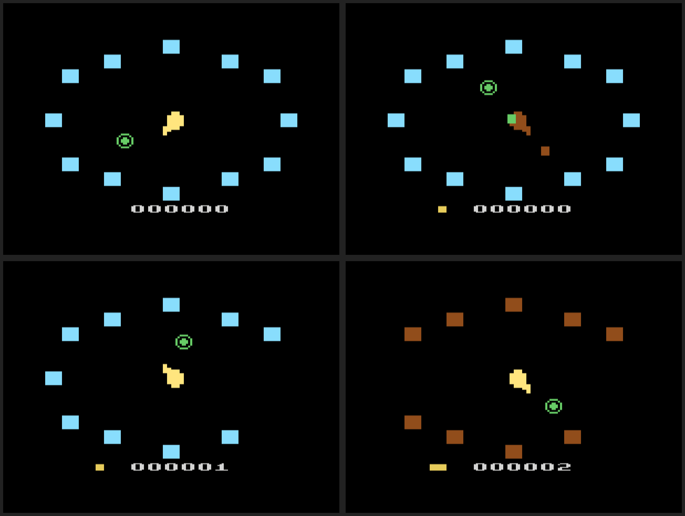

# Circular Defense – Atari 2600

Un cannone al centro dello schermo spara verso la città: 12 blocchi disposti su un anello.
Il difensore gira da solo attorno al cannone e ferma i proiettili. Tu decidi solo la velocità dell'orbita.

Ispirato al prototipo HTML *Circular Defense* e riscritto in batari Basic per Atari 2600 (PAL, cartuccia 4K).



## Comandi

| Comando | Effetto |
| --- | --- |
| Levetta a destra | Il difensore gira più veloce |
| Levetta a sinistra | Il difensore gira all'indietro |
| Fuoco | Freno: il difensore rallenta |
| Fuoco o Game Reset | Inizia una partita (dalla schermata di attesa o dopo il game over) |
| Levetta di difficoltà sinistra in A | Proiettili più veloci |
| Levetta di difficoltà destra in A | Il cannone parte più rapido |

## Regole

- Ogni proiettile fermato dal difensore vale 1 punto.
- Ogni 10 proiettili fermati si passa all'ondata successiva. I proiettili sono più veloci e il cannone spara sempre più spesso. La barra gialla in basso a sinistra conta le ondate.
- Un proiettile che arriva all'anello distrugge il blocco verso cui era diretto. Se quel blocco è già caduto, distrugge il più vicino ancora in piedi.
- Distrutti tutti i blocchi, la città lampeggia in rosso e suona la sirena: game over.
- La canna del cannone punta verso l'ultimo blocco preso di mira. Nella schermata di attesa segue il difensore.

## File

| File | Contenuto |
| --- | --- |
| `Circular Defense.bas` | Sorgente batari Basic |
| `bin/Circular Defense.bas.bin` | ROM da 4K (PAL), da aprire con Stella o da caricare su una cartuccia |
| `tools/gen_tables.py` | Genera le tabelle: anello della città, orbita del difensore, velocità dei proiettili |
| `tools/gen_sprites.py` | Genera le grafiche: torretta del cannone in 8 direzioni e difensore |
| `tests/test_game.py` | Test nell'emulatore Stella (17 controlli) |

## Come funziona

- I proiettili hanno la posizione in virgola fissa 8.8. Vanno dal centro al blocco in 64 passi, quindi seguono una linea dritta in qualsiasi direzione. La velocità (passi per frame) cresce con l'ondata.
- Il difensore ha 256 posizioni d'angolo, disegnate su 64 punti dell'orbita.
- Gli urti tra difensore e proiettili sono quelli dell'hardware (registri di collisione del TIA).
- Il cannone è disegnato a doppia larghezza. Le forme sono calcolate con le proporzioni misurate sullo schermo: un pixel è largo 4 punti, una riga è alta 3,35 punti.

## Test

```bash
cd circular_defense/tests
xvfb-run -a -s "-screen 0 800x600x24" python3 test_game.py . "../bin/Circular Defense.bas.bin" /tmp/screenshot
```
