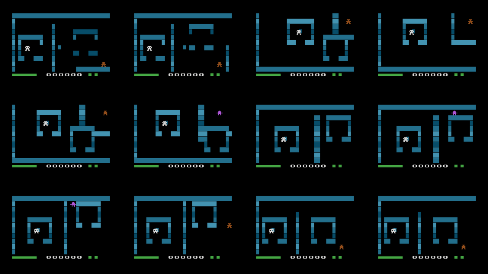

# OXYGEN 2600 – Classified Operation

Versione per **Atari 2600** del gioco Phaser *OXYGEN*: cartuccia da **8K** (bankswitching F8), PAL, scritta in batari Basic con le parti critiche in assembly.

Sei un agente in una stazione senza aria. Nelle **basi** l'ossigeno non cala; appena esci parte il conto alla rovescia. Attraversa il settore, raccogli le **2 chiavi** e attiva l'**interruttore O₂** nella base finale: il suo cancello si apre solo con tutte e due le chiavi.



Si gioca anche nel browser, dalla pagina con l'emulatore nella radice della repo ([`../index.html`](../index.html), pulsante *Oxygen*).

## Comandi

| Comando | Effetto |
| --- | --- |
| Joystick | Muove l'agente (anche in diagonale) |
| Pulsante | Spara nella direzione in cui cammini (anche contro un muro) |
| Game Reset (o pulsante nel titolo) | Nuova partita |
| Levette di difficoltà | **B B** normal, **sinistra A** hard, **destra A** beginner, **A A** expert |

## Come si gioca

- Ogni livello è un mondo di **4 stanze** (2×2), una per schermo: uscendo dal bordo si passa nella stanza accanto.
- **Ossigeno** (barra in basso a sinistra). Cala solo fuori dalle basi; il colore fa da bussola: **verde** oltre metà, **giallo**, **rosso** sotto un quarto con il bip d'allarme. Quando finisce perdi una vita e riparti dalla base di partenza, con l'ossigeno pieno; chiavi e nemici uccisi restano.
- **Basi**: entrando in una base nuova +200 punti. La **bombola** al centro della base ricarica: base sicura +15 s, standard +10 s, militare tutto (+200 punti). Poi resta vuota per circa 8 secondi (lampeggia).
- **Chiavi**: +300 punti. **Interruttore** nella base finale: +5000 punti e si passa al livello successivo. Dopo il 12° si riparte dal primo.
- **Nemici** (al massimo 2 per stanza, si alternano sullo schermo):

| Nemico | Colore | Comportamento |
| --- | --- | --- |
| Guardia | rosso | Pattuglia avanti e indietro; se ti avvicini ti insegue e spara |
| Cecchino | viola | Fermo, spara più spesso e più veloce |
| Drone | azzurro | Veloce, vola sopra i muri |
| Pesante | arancio | Lento ma resiste a molti colpi |

  Un nemico in allarme lampeggia. Ogni colpo nemico toglie **3 secondi** di ossigeno. Colpire un nemico vale 100 punti, ucciderlo 500. I colpi per abbatterlo dipendono dal tipo e dalla difficoltà.
- **Vite**: 3 (barra in basso a destra).
- **Livello 2**: la luce traballa.

Difficoltà come nell'originale:

| | Beginner | Normal | Hard | Expert |
| --- | --- | --- | --- | --- |
| Ossigeno pieno | 45 s | 30 s | 22 s | 15 s |
| Consumo | 0,5/s | 0,9/s | 1,3/s | 1,8/s |
| Nemici | lenti | | | veloci e resistenti |

## Cosa è cambiato rispetto all'originale (per stare in 8K)

- Tolti: classifica con le iniziali, crediti, schermata *continue*, rotolata, nuvole di gas, musica (restano gli effetti sonori).
- La **bussola** diventa il colore della barra dell'ossigeno.
- Mondi a stanze (2×2 schermi) invece della mappa che scorre; muri e basi sono su una griglia di 32×11 celle.
- Al massimo 2 nemici per stanza: nei livelli più affollati alcuni nemici sono tolti (il convertitore dice quanti).

## Livelli

I 12 livelli sono quelli del gioco originale (`levels/level01.json` … `level12.json`). `tools/convert_levels.py` li converte nelle stanze della cartuccia (`rooms.asm`).

- Muri e basi vanno sulla griglia; le basi hanno almeno 8×5 celle e le porte (3 colonne sopra/sotto, 2 righe ai lati).
- Davanti a ogni porta resta una cella libera prima del bordo del mondo. Se una base resta chiusa riceve una porta verso il centro della stanza.
- Il convertitore controlla che dalla base di partenza si raggiungano tutte le basi e le chiavi, e stampa le mappe.
- Ogni stanza è un elenco di pezzi (muri, basi, nemici, chiavi) che la cartuccia disegna all'ingresso: le 48 stanze occupano circa 1,2K.

## Compilare e provare

```sh
python3 tools/convert_levels.py       # -> rooms.asm (e le mappe dei livelli)
# batari Basic 1.9 + dasm: compila Oxygen.bas (rooms.asm nella stessa cartella)
xvfb-run -a python3 tests/test_oxygen.py bin/Oxygen.bas.bin /tmp/oxy   # test in Stella
```

`tests/test_oxygen.py` gioca in Stella il primo livello e controlla le meccaniche:
- ossigeno fermo nella base e in calo fuori;
- chiave raccolta e guardia uccisa;
- passaggio di stanza;
- colpo nemico che toglie 3 secondi;
- vita persa e ripartenza, con chiavi e nemici morti che restano;
- ricarica della bombola;
- interruttore con le 2 chiavi che porta al livello 2.

| File | Contenuto |
| --- | --- |
| `Oxygen.bas` | il gioco (banco 1: partita, nemici, ossigeno, suoni; banco 2: caricatore delle stanze in assembly, basi, oggetti) |
| `rooms.asm` | stanze dei 12 livelli (generato) |
| `levels/` | livelli JSON del gioco originale |
| `tools/convert_levels.py` | convertitore dei livelli |
| `tests/` | banco di prova in Stella |
| `bin/` | ROM compilata, listato e simboli |
