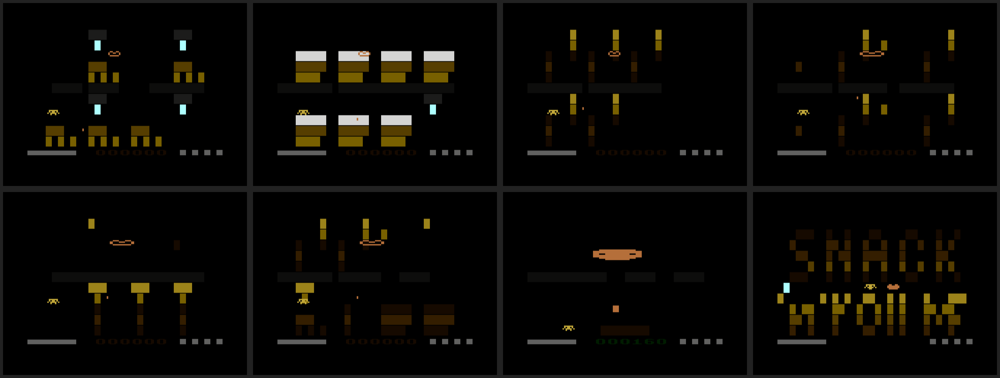
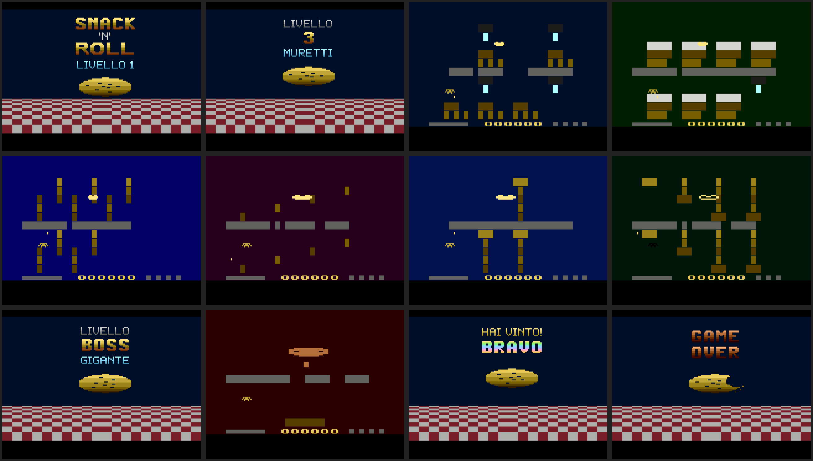

# Snack 'n' Roll – Download

Tutte le versioni del gioco, pronte da usare.

| Piattaforma | File | Come si usa |
|---|---|---|
| **Atari 2600** (originale) | [`atari2600/SnackAndRoll.bin`](atari2600/SnackAndRoll.bin) | ROM da 8K (PAL). Aprila con l'emulatore [Stella](https://stella-emu.github.io/) o caricala su una cartuccia flash (Harmony, PlusCart, UnoCart). F2 = Reset (gioca), F1 = Select (livello). |
| **Atari 2600** (sorgente) | [`atari2600/Snack and Roll.bas`](atari2600/Snack%20and%20Roll.bas) | Sorgente batari Basic da cui è compilata la ROM. |
| **Atari 2600 16K** (grafica migliorata) | [`atari2600/SnackAndRoll16K.bin`](atari2600/SnackAndRoll16K.bin) | ROM da 16K con bankswitching F6 (PAL), stessa partita della 8K: titolo ad alta risoluzione, cartelli di inizio livello, GAME OVER e vittoria, pareti colorate. Sorgente: [`atari2600/Snack and Roll 16K.bas`](atari2600/Snack%20and%20Roll%2016K.bas). |
| **Circular Defense** (Atari 2600, nuovo gioco) | [`circular_defense/CircularDefense.bin`](circular_defense/CircularDefense.bin) | ROM da 8K F8 (PAL), con paddle o joystick: difendi 6 città con il difensore che gira attorno al cannone, 8 livelli. Sorgente: [`circular_defense/Circular Defense.bas`](circular_defense/Circular%20Defense.bas). Dettagli in [`../circular_defense/`](../circular_defense/README.md). |
| **Oxygen 2600** (Atari 2600, azione) | [`oxygen/Oxygen.bin`](oxygen/Oxygen.bin) | ROM da 8K F8 (PAL): attraversa 12 settori prima che finisca l'ossigeno, prendi le chiavi e attiva l'interruttore della base finale. Sorgente: [`oxygen/Oxygen.bas`](oxygen/Oxygen.bas). Dettagli in [`../oxygen/`](../oxygen/README.md). |
| **Spike Fever 2600** (Atari 2600, pallavolo) | [`../spike_fever/spikefever2600.bin`](../spike_fever/spikefever2600.bin) · [`8k/sf8k.bin`](../spike_fever/8k/sf8k.bin) · [`4k/sf4k.bin`](../spike_fever/4k/sf4k.bin) | ROM da 16K F6 (2 contro 2, 10 nazionali, 6 livelli), da 8K F8 (4 contro 4 con titolo animato, più pose e la fisica della palla del gioco completo) e da 4K (4 contro 4), NTSC. Sorgenti assembly e istruzioni in [`../spike_fever/`](../spike_fever/README.md), dalla repository [spikeball](https://github.com/superpippoub77/spikeball). |
| **Windows** 64 bit | [`windows/SnackAndRoll-windows-x86_64.zip`](windows/SnackAndRoll-windows-x86_64.zip) | Estrai lo zip e avvia `SnackAndRoll.exe`. Al primo avvio Windows SmartScreen può avvisare che l'app non è firmata: *Ulteriori informazioni → Esegui comunque*. |
| **Linux** 64 bit | [`linux/SnackAndRoll-linux-x86_64.zip`](linux/SnackAndRoll-linux-x86_64.zip) | Estrai lo zip e avvia `./SnackAndRoll.x86_64` (se serve: `chmod +x SnackAndRoll.x86_64`). |
| **Android** (telefoni e tablet) | [`android/SnackAndRoll-android.apk`](android/SnackAndRoll-android.apk) | Copia l'APK sul telefono e aprilo. Consenti "installa app sconosciute" quando richiesto. Android 7.0 o superiore, ARM 32/64 bit. Comandi touch sullo schermo. |
| **Emulatore Atari nel browser** | [`../index.html`](../index.html) | Pagina con l'emulatore Javatari.js e le ROM Atari già caricate (Snack 'n' Roll 8K e 16K, Circular Defense, Spike Fever, Oxygen). Pubblicata su Aruba dal workflow di deploy. |
| **Browser** (anche iPhone/iPad) | [`web/`](web/) | Versione HTML5: pubblica la cartella su un qualsiasi hosting statico (GitHub Pages, itch.io…) e apri `index.html`. Non funziona aprendo il file direttamente dal disco. |

## Manuale di istruzioni

Il manuale per la box (comandi, levette di difficoltà, livelli, punteggi, consigli) è qui:
[Snack 'n' Roll – Manuale di istruzioni](https://claude.ai/code/artifact/461c41f4-fddc-4602-a24b-4cb253a66f2d).

## Schermate

Schermate della ROM Atari prese dall'emulatore Stella (1280×960, pixel nitidi, adatte alla stampa), nella cartella [`screenshots/`](screenshots/):
titolo, livelli 1-6, Bocca Gigante (livello segreto) e una tavola riassuntiva (`tavola_livelli.png`).



Versione 16K (cartella [`screenshots/16k/`](screenshots/16k/)): titolo, cartello di inizio livello, i 6 livelli, la Bocca Gigante, vittoria e GAME OVER.



## Note

- Le versioni Windows, Linux, Android e Web sono il **porting Godot 4.3**: un platform a scorrimento orizzontale che usa la stessa logica del BAS.
  Il codice sorgente è in [`../snack_and_roll_godot/`](../snack_and_roll_godot/README.md).
- La ROM Atari è stata ricompilata dal sorgente più recente con batari Basic 1.9 e dasm.
- L'APK Android è firmato con una chiave di sviluppo (installazione manuale, non Play Store).
  Per aggiornarlo con una build firmata con una chiave diversa, disinstalla prima la versione precedente.
- iOS: un'app nativa richiede macOS e Xcode. Su iPhone e iPad si può giocare con la versione **Browser**.

## Verifiche fatte

| Versione | Come è stata provata |
|---|---|
| Atari 2600 | Emulatore Stella: partita completa dal livello 1 alla vittoria giocata in automatico con i tasti. Sono 515 controlli (più il test delle levette di difficoltà) su zuccherini, bocche, sacchetto, appoggi degli oggetti, luce, tempo, vite, muri spingibili, suoni e Bocca Gigante, più un test delle novità di giocabilità (fuga finale, tempo in scadenza, bonus tempo, fine del super potere, combo) ([`snack_and_roll/tests`](../snack_and_roll/tests/README.md)) |
| Windows | Wine 9 su Linux: avvio, titolo, partita |
| Linux | Avvio diretto del binario esportato |
| Browser | Chromium: caricamento, titolo, partita, nessun errore in console |
| Android | Firma APK verificata con `apksigner` (v1/v2/v3); da provare su un dispositivo |

## Come ricompilare

```bash
# Atari 2600 (batari Basic 1.9)
2600basic.sh "Snack and Roll.bas"

# Godot (dalla cartella snack_and_roll_godot, template di esportazione 4.3 installati)
godot --headless --path . --export-release "Windows"
godot --headless --path . --export-release "Linux"
godot --headless --path . --export-release "Web"
godot --headless --path . --export-release "Android"   # richiede Android SDK e keystore
```
